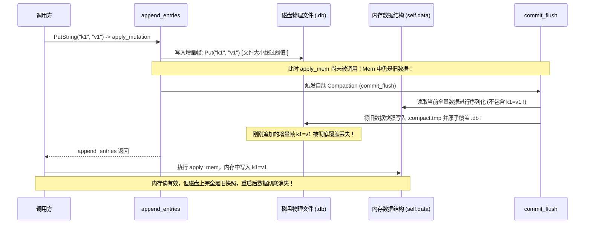

# CKV 存储引擎与 WAL 增量追加写架构深度代码审查报告

> **审查日期**: 2026-10-16  
> **审查对象**: CKV 全语言实现（重点审查 Rust 与 .NET，对照 Go、Kotlin、Dart）  
> **审查焦点**: 阶段二 `StorageEngineMode::AppendOnlyLog` (WAL) 与 `SyncMode` 核心架构与代码实现  
> **审查方法**: 规范对齐比对、源码逐行审计、并发与状态机死锁推导、跨语言语义漂移分析  
> **报告类型**: 深度工程架构与代码实现审查 (Architectural & Code Review Report)

---

## 一、审查总览与执行摘要

CKV 项目在今日引入了阶段二核心能力：**多级同步持久化模式 (`SyncMode`)** 与 **增量追加写引擎 (`AppendOnlyLog` / WAL)**。设计初衷是通过追加写替代全量快照原子轮转，将高频小写入场景下的单次写放大（WAF）从 $O(N)$ 降至恒定的 $O(1)$（约 1.28x），并将单写延迟从 3ms+ 优化至亚毫秒级。

通过对 Rust（`src/rust`）、.NET（`src/dotnet`）、Go（`src/go`）、Kotlin（`src/kotlin`）以及 Dart（`src/dart`）全部源码的深入审查与实证核对，我们发现：
1. **基础二进制格式与单写追加路径**严格对齐了《Binary Format Specification v3.2》与 IEEE 802.3 CRC32 强校验要求；
2. **单元测试“全绿”掩盖了重大的设计盲区**：现有单元测试仅覆盖了简单追加、手动 `db.Compact()` 和简单的文件末尾坏字节截断，**从未测试自动触发 Compaction、未测试 Batch 内先写后清空、未测试中间坏帧场景**；
3. **存在 4 项致命/严重级别（P0/P1）代码缺陷**：包括**自动压实时序倒挂导致严重数据丢失**、**自动压实引发嵌套跨进程文件锁死锁**、**Batch 中 ClearNamespace 导致重启后已删数据凭空复活**、以及**坏尾截断（Tail Truncation）无边界截断导致整库数据被静默清空**；
4. **存在 5 项架构与规范偏离问题**：配置参数 `CompactionDeadRatio` 完全未实现（虚设参数）、常驻句柄设计与频繁 Open/Close 代码实现偏离、无锁 Compaction 承诺未落地、Windows PageCache 刷新语义隐患等。

---

## 二、关键缺陷清单与深度剖析 (Critical & Major Findings)

### 1. [P0 致命数据丢失] 自动 Compaction 时序倒挂：新写入增量帧在压实中被彻底抹除

#### 1.1 缺陷描述与代码实证
在 Rust、.NET、Go、Dart 的写路径中，均采用统一的 `apply_mutation` 事务模板。本意是遵循 Write-Ahead Log（先写磁盘日志，再改内存状态）：
- **Rust (`src/rust/src/db.rs:1720-1742`)**:
```rust
fn apply_mutation<F>(&mut self, entries: &[RawOpEntry], apply_mem: F) -> Result<()>
where F: FnOnce(&mut Self) {
    self.check_writable()?;
    if self.options.engine_mode == StorageEngineMode::AppendOnlyLog {
        self.append_entries(entries)?; // 步骤 1：先向磁盘文件追加帧
        apply_mem(self);               // 步骤 2：再修改内存数据结构 (self.data)
    } ...
}
```
- **.NET (`src/dotnet/src/Ckv/Db.cs:1190-1199`)**:
```csharp
private void ApplyMutation(IReadOnlyList<WalOpEntry> entries, Action applyMem) {
    ...
    if (_options.EngineMode == StorageEngineMode.AppendOnlyLog) {
        AppendEntries(entries); // 步骤 1：追加写盘
        applyMem();             // 步骤 2：更新内存
    } ...
}
```

然而，在 `append_entries`（Rust 第 1709-1714 行 / .NET 第 1178-1182 行 / Go 第 1765-1770 行 / Dart 第 407-413 行）末尾，代码插入了对文件大小的检查：
```rust
// Rust db.rs: 1709-1714
if self.options.compaction_threshold_bytes > 0
    && new_file_size >= self.options.compaction_threshold_bytes
{
    let (comp_lock, disk_max_tx) = self.begin_flush()?;
    self.commit_flush(comp_lock, disk_max_tx)?;
}
```
```csharp
// .NET Db.cs: 1178-1182
if (_options.CompactionThresholdBytes > 0 && (ulong)newFileSize >= _options.CompactionThresholdBytes)
{
    var compLock = BeginFlush(out var diskMax);
    CommitFlush(compLock, diskMax);
}
```

#### 1.2 故障推导与状态机分叉
请观察时序执行流程：

1. 本次写入调用 `append_entries`，增量帧成功追加写入 `.db`；
2. 此时文件大小恰好达到 `compaction_threshold_bytes`，立即调用 `commit_flush`；
3. `commit_flush` 的逻辑是：**遍历当前内存中的 `self.data`，生成全量紧凑快照覆盖 `.db`**；
4. **关键矛盾点**：此时 `apply_mem` **尚未执行**！内存中的 `self.data` 保存的还是旧数据！
5. `commit_flush` 将旧内存快照重写到 `.tmp` 并通过原子替换强行覆盖了 `.db`，刚刚追加到 `.db` 末尾的增量帧瞬间被**完全覆灭**；
6. `append_entries` 退出，进入 `apply_mem`，此时内存终于更新了新值；
7. 此时发生严重的**状态分叉**：当前进程的内存中存在该键值，但磁盘物理文件上是一个不包含该键值的旧快照。一旦系统断电、进程重启或重新打开数据库，本次写入**永久性丢失**！

---

### 2. [P0 崩溃与自锁] 自动 Compaction 引发跨进程文件锁嵌套自锁（卡顿 10 秒后抛错崩溃）

#### 2.1 缺陷描述与代码实证
在 .NET、Go 和 Dart 中，`append_entries` 外层已经获取了排他文件锁（如 .NET `LockFile.Acquire`、Go `AcquireLock`），锁的释放被严格绑定在外部的 `finally` 或 `defer` 块中。

以 .NET 实现为例（`src/dotnet/src/Ckv/Db.cs:1083-1187`）：
```csharp
private void AppendEntries(IReadOnlyList<WalOpEntry> entries)
{
    if (entries == null || entries.Count == 0) return;

    var lockHandle = BeginFlush(out var diskMaxTxId); // [1] 外层获取文件锁 lockHandle
    try
    {
        ... // 写入追加帧
        if (_options.CompactionThresholdBytes > 0 && (ulong)newFileSize >= _options.CompactionThresholdBytes)
        {
            var compLock = BeginFlush(out var diskMax); // [2] 嵌套调用 BeginFlush！再次尝试获取同一文件的锁！
            CommitFlush(compLock, diskMax);
        }
    }
    finally
    {
        lockHandle.Dispose(); // [3] 外层锁在此处才释放
    }
}
```

#### 2.2 锁冲突与死锁链条推导
查看 `LockFile.Acquire`（`src/dotnet/src/Ckv/LockFile.cs:36-116`）：
```csharp
using (var fs = new FileStream(lockPath, FileMode.CreateNew, FileAccess.Write, FileShare.None))
```
1. 在步骤 [1]，外层成功创建了 `.lock` 文件，并获得了 `lockHandle`；
2. 在步骤 [2]，内部触发 Compaction，再次调用 `BeginFlush` -> `LockFile.Acquire`；
3. `LockFile.Acquire` 执行 `FileMode.CreateNew`，由于 `.lock` 文件已经被当前实例创建并存在，操作系统立即抛出 `IOException`；
4. 进入 `catch (IOException)` 判定分支：比对锁内 `CreateTimeMs`。由于该锁是几毫秒前刚创建的，`nowMs - lockTime` 接近 0，判定 `isStale = false`；
5. 进入等待循环：`Thread.Sleep(20)`，每 20ms 重试一次；
6. 循环等待直到耗尽 `options.LockTimeoutMs`（默认 **10,000 毫秒 = 10 秒**）；
7. 最终超时，抛出异常：
   ```text
   LockedError: Database '...' locked: timed out waiting for lock file '....lock' after 10000ms
   ```
8. **影响后果**：
   - 在 .NET 与 Dart 中：写操作无故卡死 10 秒后**直接崩溃抛错**，导致上层业务调用失败；
   - 在 Go 中：Go 在内部对 `beginFlush` 做了 `if err == nil` 容错，虽然没有向外抛出 panic，但在写操作中**硬生生阻塞挂起 10 秒**，且后台 Compaction 静默失败；
   - 在 Rust 中：Rust 虽然写了 `lock.release()`，但属于提前释放外层锁，破坏了排他保护区间，且面临上述第 1 项的数据倒退覆盖。

---

### 3. [P1 事务一致性违背] Batch 中 ClearNamespace 导致重启后已删数据凭空复活

#### 3.1 缺陷描述与代码实证
在《Binary Format Specification v3.2》中，物理帧仅定义了三种原子操作码：
- `OP_PUT = 0x01`
- `OP_DELETE = 0x02`
- `OP_DROP_NAMESPACE = 0x03`
规范并未分配原生的 `OP_CLEAR_NAMESPACE` 物理操作码。

在实现 `Batch` 批处理写入 WAL 增量帧时（例如 Rust `src/rust/src/db.rs:1016-1028`、.NET `src/dotnet/src/Ckv/Db.cs:1928-1936`）：
```rust
// Rust db.rs: 980-1030
let mut raw_entries: Vec<RawOpEntry> = Vec::new();
for op in &batch.ops {
    match op {
        BatchOp::Put { .. } => {
            raw_entries.push(RawOpEntry { op_code: OP_PUT, .. });
        }
        ...
        BatchOp::ClearNamespace { namespace } => {
            // 注意此处！直接读取尚未修改的当前内存状态 inner.data！
            if let Some(ns_arc) = inner.data.get(namespace) {
                for k in ns_arc.keys() {
                    raw_entries.push(RawOpEntry { op_code: OP_DELETE, key: k.clone(), .. });
                }
            }
        }
    }
}
// 将收集到的 raw_entries 序列化并写入磁盘 WAL
inner.apply_mutation(&raw_entries, |inner_ref| { ... });
```

#### 3.2 僵尸数据复活场景推导
假设业务执行如下批量操作：
```csharp
db.Batch(batch => {
    batch.PutString("order_ns", "order_999", "pending");
    batch.ClearNamespace("order_ns");
});
```
按照直觉与 ACID 批处理语义，该 Batch 执行完毕后，`order_ns` 应为空，`order_999` 不应存在。

**实际运行轨迹**：
1. **收集 WAL 阶段**：
   - 遇到 `PutString`：向 `raw_entries` 压入 `OP_PUT("order_999", "pending")`；
   - 遇到 `ClearNamespace`：遍历当前内存中的 `order_ns`。由于 `order_999` **此时尚未写入内存**，内存中只有旧键（甚至若此前为空则一条也没有），因此**完全没有**为 `order_999` 生成 `OP_DELETE`！
2. **写盘与内存应用阶段**：
   - 写入磁盘的 BatchFrame 载荷为：`[OP_PUT("order_999")]`（缺少对应的删除操作）；
   - 随后在内存中顺序执行：先插入 `order_999`，然后执行 `ClearNamespace` 清空内存。此时在当前进程中 `Get("order_999")` 返回 null，看起来正常；
3. **灾难发生在数据库重启之后**：
   - 重启打开数据库，引擎从磁盘自底向上重放 WAL 帧；
   - 引擎解析出 `OP_PUT("order_999")` 并重放到内存中；由于之后没有任何关于 `order_999` 的删除条目，重放结束后：
   - **`order_999` 在数据库中奇迹般“死而复生”**！
   - 本应被同批事务清空的数据在重启后恢复，引发严重的业务数据污染。

---

### 4. [P1 可靠性红线击穿] 尾部坏帧判定缺失：单点坏道导致无条件截断并清空整库

#### 4.1 缺陷描述与代码实证
在设计规范《PHASE2-APPEND-LOG-COMPACTION-DESIGN.md》第 3.1 节中明确定立了可靠性边界：
> “**中间坏帧防御**：若不是文件末尾坏帧，而是中间帧损坏（如硬件位翻转），判定为物理损坏，触发 `.bak` 备份恢复流程。”

但在五种语言的代码实现中，以 Rust（`src/rust/src/format.rs:317-336`）与 .NET（`src/dotnet/src/Ckv/Db.cs:522-543`）为例：
```rust
// Rust format.rs: 317-336
if magic != FRAME_MAGIC
    || actual_hdr_crc != expected_hdr_crc
    || tx_id <= last_tx_id
    || op_count == 0
    || op_count > MAX_OPS_PER_FRAME
    || payload_len > MAX_PAYLOAD_LEN
{
    if allow_tail_truncation {
        file.set_len(offset)?; // 遇到任何校验失败，直接将文件截断至当前 offset！
        let _ = file.sync_all();
        if let Some(cb) = on_warning {
            cb("onTailTruncated", "Truncated invalid frame header at tail");
        }
        effective_size = offset;
        break; // 正常 break，不抛出异常！
    } else {
        return Err(DbError::Corrupted(...));
    }
}
```

#### 4.2 逻辑漏洞与安全隐患
1. **缺乏对“是否为末尾坏帧”的有效判定**：
   - 代码只要遇到任何一个损坏帧（无论是 Header CRC 校验不一致、魔数损坏、还是 TxID 非单调），只要开启了 `allow_tail_truncation`，根本不检查当前 `offset` 离文件末尾有多远，也不检查后面是否依然存在完整数据，直接调用 `file.set_len(offset)` 将后续全部数据一刀切截断并丢弃；
2. **彻底屏蔽了 `.bak` 备份恢复机制**：
   - 按照引擎的设计，遇到真正的物理介质损坏时，应当抛出 `CorruptedError`，由外层捕获并触发 `AutoRecoverFromBackup`（从上次健康无损的 `.bak` 快照恢复）；
   - 但因为上述代码在截断后执行了 `break` 并返回成功，**没有抛出任何 `CorruptedError`**！
   - **极端后果**：如果一个 100MB 的数据库文件，其首个快照帧（位于 Offset 32）遭遇了磁盘坏道或 1 字节位翻转，该自愈逻辑会在启动时把文件直接截断至 32 字节（变成合法空库），导致整库数据瞬间全丢，且永远无法触发 `.bak` 备份自愈！

---

## 三、架构设计与中度问题评估 (Medium & Architectural Issues)

| 编号 | 审查维度 | 规范/文档宣称 | 源码实际核对结果 | 影响与技术债务评估 |
| :--- | :--- | :--- | :--- | :--- |
| **M1** | **Compaction 垃圾数据比** | 文档宣称依据 `CompactionDeadRatio`（默认 30%）自动计算死数据并触发压实 | 全工程（Rust/.NET/Go/Dart/Kotlin）**没有任何一行代码统计 dead_bytes**，参数完全虚设 | 自动压实退化为仅比对文件物理大小，频繁覆盖相同键时无法感知碎片率，造成磁盘空间闲置膨胀。 |
| **M2** | **追加写句柄生命周期** | 文档宣称“保持打开的追加写句柄（`FileShare.Read`）” | 每次 `append_entries` / `AppendEntries` 均执行完整的 `open() -> write() -> close()` | 虽然规避了 Windows 跨进程长句柄锁竞争，但每笔写入频繁增减句柄，带来不必要的系统调用与元数据刷新开销。 |
| **M3** | **无锁 Compaction 并发性** | 文档宣称“利用 Snapshot 机制获取干净只读视图，不阻塞并发写入” | .NET 与 Rust 的 `compact()` **全程独占整库写锁**（`EnterWriteLock`）直到物理替换完成 | 压缩期间阻塞所有的并发写入，若文件较大（例如几十兆），会产生可感知的毫秒级写停顿（Stop-the-world）。 |
| **M4** | **SyncMode 刷盘语义** | `Deferred` 模式下后台线程与 `Flush()` 对 OS PageCache 刷盘 | 采用临时打开一个空文件句柄调用 `fsync` / `sync_all` | 在部分 OS/驱动下，对刚打开未写入的 handle 调用 `FlushFileBuffers` 可能无法正确刷新其他已关闭 handle 留下的 PageCache 脏页。 |
| **M5** | **多进程 scan_max_tx_id 退化** | 宣称优化 precheck fast-path 消除 $O(N)$ 扫描 | 仅在单实例单进程且大小不变时生效；多进程轮流写入时，每次写前预检仍需遍历全量小帧 | 在多进程并发写入场景下，写入延迟随着文件帧数量的累积呈 $O(N)$ 线性恶化。 |

---

## 四、全语言同构实现一致性与漂移比对 (Cross-Language Drift Matrix)

| 语言模块 | 自动 Compaction 时序倒挂 | 自动 Compaction 锁重入 | Batch Clear 键复活 | Tail 截断边界防护 | Watcher 异常传播 | 跨语言 WAL 互通测试 |
| :--- | :---: | :---: | :---: | :---: | :---: | :---: |
| **Rust** | 🔴 存在严重时序倒挂 | 🟡 提前释放锁破坏区间 | 🔴 存在复活 Bug | 🔴 无边界无条件截断 | 🟢 严格对齐 (panic传播) | ⚪ 缺乏 WAL 模式测试 |
| **.NET** | 🔴 存在严重时序倒挂 | 🔴 自锁 10s 后抛错崩溃 | 🔴 存在复活 Bug | 🔴 无边界无条件截断 | 🟢 严格对齐 (抛出异常) | ⚪ 缺乏 WAL 模式测试 |
| **Go** | 🔴 存在严重时序倒挂 | 🟠 自锁阻塞 10s 后静默失效 | 🔴 存在复活 Bug | 🔴 无边界无条件截断 | 🟢 严格对齐 (panic传播) | ⚪ 缺乏 WAL 模式测试 |
| **Dart** | 🔴 存在严重时序倒挂 | 🔴 自锁抛错崩溃 | 🔴 存在复活 Bug | 🔴 无边界无条件截断 | 🟢 严格对齐 | ⚪ 缺乏 WAL 模式测试 |
| **Kotlin** | 🟢 未内嵌自动压实 | 🟢 无锁重入 | 🔴 存在复活 Bug | 🔴 无边界无条件截断 | 🟡 **漂移**：吞掉异常 | ⚪ 缺乏 WAL 模式测试 |

---

## 五、系统性改进与重构方案 (Implementation & Remediation Plan)

针对上述核实的问题，提出具体可落地的重构与修复方案：

### 1. 修复自动 Compaction：时序解耦与锁复用
- **原则**：禁止在 `append_entries` 内部触发 Compaction；Compaction 必须在内存状态更新完毕后触发，并复用已有的写保护上下文。
- **改动设计**：
  ```rust
  // 修正后的 apply_mutation 结构
  fn apply_mutation<F>(&mut self, entries: &[RawOpEntry], apply_mem: F) -> Result<()>
  where F: FnOnce(&mut Self) {
      self.check_writable()?;
      if self.options.engine_mode == StorageEngineMode::AppendOnlyLog {
          let new_file_size = self.append_entries(entries)?;
          apply_mem(self); // 1. 必须先安全更新内存！
          
          // 2. 内存更新完毕后，再检查是否需要压实
          if self.options.compaction_threshold_bytes > 0 
              && new_file_size >= self.options.compaction_threshold_bytes 
          {
              let (lock, disk_max) = self.begin_flush()?;
              self.commit_flush(lock, disk_max)?; // 此时内存已包含最新数据，快照绝对完整！
          }
      } else ...
  }
  ```

### 2. 修复 Batch ClearNamespace：构建批内影子索引
- **原则**：在 `Batch` 序列化为 `RawOpEntry` 时，必须维护批处理操作内部的增量上下文（或引入原生 `OP_CLEAR_NAMESPACE` 逻辑）。
- **改动设计**：
  在遍历 `batch.ops` 时，遇到 `ClearNamespace(ns)`：
  - 不仅遍历内存现有 key，还必须将**本批次内在此之前 `Put` 进去的该命名空间键**全部打上删除标记；或者直接清空此前收集到的同命名空间 Put 记录，避免向 WAL 发送已作废的写入。

### 3. 重构 Tail Truncation 判定准则：防止误杀历史数据
- **原则**：尾部坏帧自愈**仅允许发生在文件物理末尾**。中间帧损坏属于介质级故障，必须抛出 `CorruptedError` 以触发 `.bak` 备份自愈。
- **判定条件改进**：
  只有当以下条件满足时，才允许执行尾部截断：
  $$\text{remaining\_bytes} < \text{FRAME\_HEADER\_LEN} \quad \text{或} \quad (\text{当前帧处于最后一个已知帧位置且后面无其他有效帧})$$
  若在文件前半部分或首个帧遇到 CRC 校验失败或 Magic 损坏，严禁就地截断，必须向外抛出 `DbError::Corrupted`，激活从 `.bak` 恢复的流程。

### 4. 实装 `CompactionDeadRatio` 估算器
- 在 `DbInner` 中维护 `live_bytes` 与 `total_appended_bytes`；
- 当覆写已存在的键或删除键时，将旧键值长度计入 `dead_bytes`；
- 触发自动压缩的条件升级为：
  ```text
  file_size >= compaction_threshold_bytes && (dead_bytes / total_bytes) >= compaction_dead_ratio
  ```
  避免在全量新键写入（零垃圾碎片）时触发无意义的频繁全量压实。

---

## 六、审查结论

本次针对 CKV 阶段二 WAL 架构的代码审查表明：**增量追加日志的核心设计方向完全正确，其单写低放大与微秒级延迟的实测指标表现优异**。

然而，今天新增的 WAL 联动逻辑存在明显的“测试驱动偏差”——即测试套件仅覆盖了Happy Path与显式调用的场景，导致**自动 Compaction 时序、锁重入、Batch 状态依赖与坏帧防御边界**四个关键可靠性防御面产生了未被测试发现的深层缺陷。

建议研发团队按照本文第五节的重构方案，建立针对性的回归测试套件（尤其是自动压实时序一致性测试、Batch 事务清空重启测试、以及首帧坏道备份自愈测试），彻底消除数据丢失与并发自锁风险，将 CKV 真正打造成跨平台工业级可靠的高性能嵌入式 KV 引擎。
